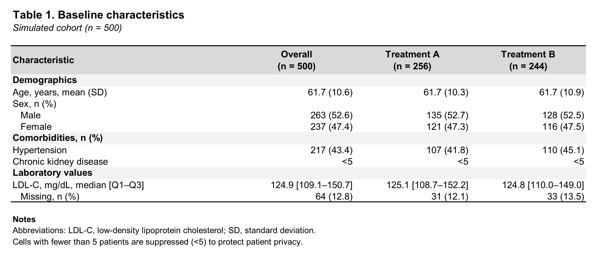
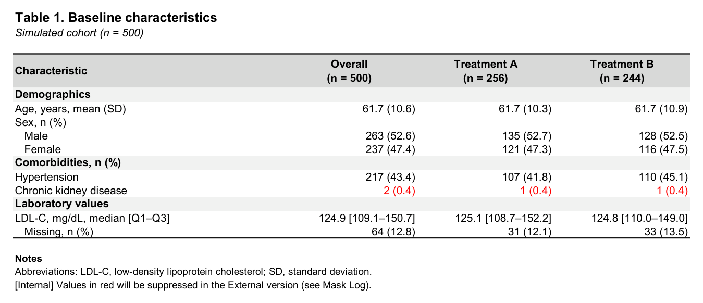
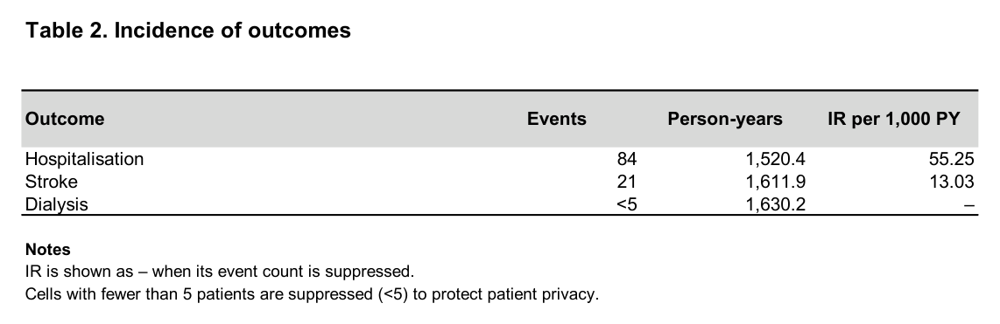
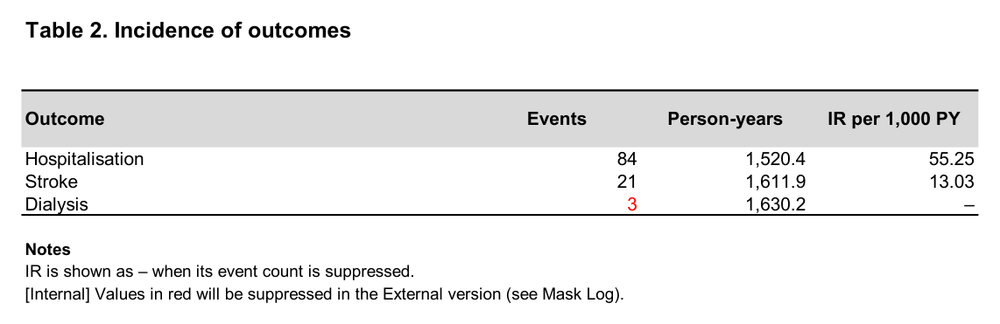

# r-masked-workbook

분석 결과를 **서식이 갖춰진 Excel 결과 보고서**로 만들고, 환자 수가 1~4명인 칸을 **자동으로 가리는(<5)** R 패키지(`maskxl`)입니다.

## 왜 만들었나
결과표를 엑셀로 옮길 때마다 서식을 다시 맞추고, 외부로 보내기 전에 5 미만인 칸을 눈으로 찾아 지우는 일이 반복됐습니다.
사람이 찾으면 빠뜨리기 쉽고, 이미 `"3 (0.2)"`처럼 문자열이 된 표에서는 판단도 어렵습니다.
그래서 **숫자 단계에서 가릴 칸을 먼저 정하고**, 그다음에 글자로 바꾸도록 만들었습니다.

## 한 번에 두 벌
| 파일 | 내용 |
|---|---|
| External (송부용) | 1~4는 `<5`, 그 값에서 계산된 비율 등은 `–` |
| Internal (검토용) | 원래 값을 그대로 두고 가려질 칸만 **빨간 글씨**, `_Mask Log` 시트에 가린 칸 목록 |

두 파일 모두 목차(시트 하이퍼링크), 개요, 번호가 붙은 표(Table 0, 1, 2 …), 각주가 자동으로 들어갑니다.

**External**: 1~4명인 칸은 `<5`

**Internal**: 같은 칸이 원래 값 그대로 빨간 글씨

**파생값**: 사건 수가 가려지면 발생률도 `–` (왼쪽 External, 오른쪽 Internal)

 

난수로 만든 가상 데이터로 만든 결과

## 마스킹 규칙
| 규칙 | 내용 |
|---|---|
| 1차 | count 1~4 → `<5`. 0은 그대로 |
| 연속형 | 유효 n이 5 미만이면 mean (SD)·median을 `–` |
| 파생값 | 기준 count가 가려지면 그 값으로 계산한 열(예: 발생률)도 `–` |
| 역산 방지 (선택) | 합계로 역산할 수 있으면 다음으로 작은 칸도 `n/r`. `mx_baseline(..., secondary = TRUE)` |

## 구성
- R 패키지 `maskxl`: 엑셀 쓰기·마스킹 약 550줄, 함수 5개(`mx_describe` `mx_baseline` `mx_table` `mx_write_workbook` `mx_check_masking`)
- 테스트 31개: 숫자 서식, 1차·역산 방지 마스킹, 연속형·파생값 처리, 실제 파일 쓰기와 마스킹 점검
- Claude Code 스킬(`masked-results-xlsx`): "이 결과로 엑셀 만들어줘"라고 하면 Claude가 R 스크립트를 쓰고 실행해 두 파일을 만들고 점검까지 합니다. 마스킹 판단은 항상 코드가 하고, AI는 표 구성과 실행만 맡습니다.
- 결과 예시 파일: [`docs/examples/`](docs/examples) (External·Internal을 나란히 열어 보면 차이가 보입니다)

## 코드
이 저장소는 **소개용**입니다. 소스 코드는 비공개로 관리합니다.
채용·협업 등으로 코드를 보고 싶으시면 [프로필](https://github.com/pkjphj2)의 연락처로 알려 주세요.

## License
All rights reserved. 열람만 허용하며, 허락 없이 복제·수정·배포·사용할 수 없습니다. 자세한 내용은 [LICENSE](LICENSE).
